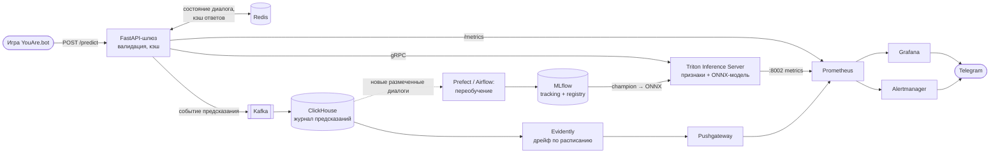

# YouAre.bot — классификатор «бот или человек»

Курсовой проект Production ML. Для каждого участника короткого диалога модель
предсказывает вероятность того, что это бот. Данные — соревнование
[You Are Bot](https://stackmorelayers.ai/competitions/you-are-bot), метрика — LogLoss.

## Быстрый старт

Нужны [uv](https://docs.astral.sh/uv/) и bash (Linux/macOS; на Windows — Git Bash).
Полный прогон занимает около 40 минут на ноутбуке без GPU (из них ~15 минут — стекинг).

```bash
# 1. Данные соревнования положить в data/raw/ (см. data/README.md)
# 2. Всё остальное — одной командой:
./run_experiment.sh
```

Скрипт по шагам:

1. `uv sync --locked` — ставит окружение строго по `uv.lock` (Python 3.12).
2. `pytest` — тесты кода на синтетических диалогах.
3. `youarebot validate-data` — контракт данных (Pandera) и сверка SHA-256 файлов.
4. `youarebot run configs/experiments/*.yaml` — эксперименты: кросс-валидация,
   обучение, логирование всего в MLflow. Затем подбор гиперпараметров:
   каждый вариант (`--set model.params.C=…`) — отдельный запуск.
5. `youarebot promote` — две лучшие конфигурации по `cv_logloss` получают
   алиасы `champion` и `challenger` в Model Registry.
6. `youarebot predict` — сабмит `submissions/submission.csv` моделью `champion`
   из реестра.
7. `youarebot demo` — вероятность «бот» после каждой реплики тестового диалога.

Посмотреть эксперименты:

```bash
uv run mlflow ui --backend-store-uri sqlite:///mlflow.db --port 5000   # http://127.0.0.1:5000
```

## Результаты

Кросс-валидация: 5 фолдов, группировка по диалогам, среднее по фолдам ± std.
Все числа воспроизводятся `./run_experiment.sh` на данных версии `6009d4183b37`.

| Эксперимент | CV LogLoss | ROC-AUC | Accuracy | Время CV |
|---|---|---|---|---|
| 01 константа (доля ботов в train) | 0.676 | 0.500 | 0.592 | 1 с |
| 02 TF-IDF + логрегрессия, только свой текст | 0.459 ± 0.022 | 0.894 | 0.780 | 7 с |
| 03 + ручные признаки и текст собеседника | 0.209 ± 0.036 | 0.975 | 0.921 | 8 с |
| 04 CatBoost на ручных признаках | 0.191 ± 0.025 | 0.977 | 0.919 | 29 с |
| 05 CatBoost + тексты (мешок слов по умолчанию) | 0.186 ± 0.022 | 0.979 | 0.921 | 439 с |
| 06 бленд 03 + 04 | 0.175 ± 0.019 | 0.980 | 0.927 | 59 с |
| 07 CatBoost + тексты (NaiveBayes + BM25) | 0.173 ± 0.027 | 0.981 | 0.928 | 71 с |
| 08 бленд 03 + 07 (веса 0.35 / 0.65) — challenger | 0.163 ± 0.019 | 0.983 | 0.932 | 67 с |
| 09 = 07 + начала диалогов | 0.172 ± 0.028 | 0.982 | 0.931 | 51 с |
| **10 стекинг по логитам — champion** | **0.147 ± 0.021** | **0.986** | **0.941** | ~19 мин |

Подбор гиперпараметров тоже идёт отдельными запусками в MLflow (`--set`):
C логрегрессии из {0.25, 0.5, 1, 2, 4} — лучший 2 (0.209 против 0.210–0.222);
глубина CatBoost из {4, 6, 8} — лучшая 6 (0.173 против 0.178 и 0.180).
Вес логрегрессии в бленде (0.35) выбран по out-of-fold предсказаниям.

**Начала диалогов как аугментация** (`augment` в конфиге): для каждого диалога до 4
случайных начал длины от 2 реплик получают метки целого диалога и добавляются
в обучение с весом 0.5. На кросс-валидации начала берутся только из обучающих
диалогов фолда, а качество считается на целых диалогах.

**Стекинг** (`10_stack.yaml`, класс `LogitStack`): логистическая регрессия поверх
логитов трёх моделей — логрегрессии на TF-IDF и CatBoost с началами диалогов и того же
CatBoost без них. Метамодель учится на out-of-fold предсказаниях внутренней групповой
кросс-валидации. Усреднение вероятностей (бленд) делает прогноз недоуверенным, а сумма
логитов со свободными весами — нет: 0.163 → 0.147. Модели с началами и без них ошибаются
по-разному (корреляция логитов 0.97), на этом стекинг и выигрывает.

**Что проверили и не взяли** (отрицательный результат — тоже результат):

* *Постобработка «в диалоге не больше одного бота».* Помогает модели, которая не видит
  собеседника (02: 0.489 → 0.459), но ухудшает все модели с признаками собеседника
  (например, 0.176 → 0.179): структура пары уже учтена, повторный учёт делает прогноз
  переуверенным. Выключена по умолчанию; в каждом запуске логируются обе версии
  метрик — `oof_raw_*` и `oof_*`.
* *Полная обработка текстов в CatBoost* (мешок слов и биграмм): в 6 раз медленнее
  и хуже облегчённой (05 против 07).
* *Эмбеддинги `intfloat/multilingual-e5-small`* (усреднение по репликам): в бленде дают
  лишь −0.002…−0.004 logloss ценой torch (+600 МБ) и минуты счёта на каждый запуск.
* *Стекинг с вероятностью собеседника, температурная калибровка* — выигрыш ≤ 0.001.
* *Усреднение CatBoost по 5 seed* — 0.1734 против 0.1730 у одного seed: прироста нет,
  зато видно, что разброс от seed порядка ±0.002 — меньшие разницы между моделями
  нельзя считать значимыми.
* *Модель уровня диалога* (3 исхода: нет бота / бот 0 / бот 1) — 0.20, хуже
  поучастниковой; в стекинге тоже не помогла.

**Анализ ошибок** (out-of-fold, модель до добавления признаков ритма): половину logloss
дают 5% уверенно ошибочных участников. Хуже всего модель работает на диалогах
«человек + человек» (logloss 0.31) — она привыкла, что в 82% диалогов есть бот, —
и на коротких диалогах до 3 реплик (0.28). Признаки ритма ответов
(`gets_reply_share`, `reply_len_ratio_mean`, `max_run`) появились по итогам этого
разбора и дали −0.004…−0.010.

**Внешняя проверка.** Публичный лидерборд: бленд 08 — **0.1322**; стекинг 10 —
_впишите после сабмита_. Лидерборд лучше CV, потому что в тесте диалоги в среднем
длиннее (7.5 реплики против 6.9), а на длинных диалогах модель ошибается реже.

**Онлайн-сценарий** (`youarebot demo`): структурные признаки («кто говорил последним»,
доля реплик) по ходу живого чата смещаются в пользу автора текущей реплики.
Аугментация началами диалогов частично учит модель незаконченным разговорам; следующий
шаг — отдельная модель для онлайна, обученная и проверенная именно на началах.


## Структура

```
project/
├── run_experiment.sh          # сквозной запуск одной командой
├── pyproject.toml, uv.lock    # зависимости, зафиксированные с хешами
├── configs/
│   ├── base.yaml              # общие настройки: данные, CV, seed, MLflow
│   └── experiments/*.yaml     # по файлу на эксперимент: модель и её параметры
├── data/
│   ├── README.md              # откуда взять данные
│   ├── checksums.sha256       # версия данных, на которой получены результаты
│   └── raw/                   # данные соревнования (не в git)
├── notebooks/01_eda.ipynb     # разведочный анализ (исполнен, с выводами)
├── reports/figures/           # графики EDA
├── src/youarebot/
│   ├── data.py                # чтение JSON/CSV, контрольные суммы
│   ├── validation.py          # контракт данных: схемы Pandera, целостность
│   ├── features.py            # признаки участника и собеседника
│   ├── augment.py             # начала диалогов как аугментация обучения
│   ├── models.py              # фабрика моделей: логрег, CatBoost, бленд, стекинг
│   ├── postprocess.py         # учёт «в диалоге не больше одного бота»
│   ├── train.py               # CV, финальная модель, логирование в MLflow
│   ├── registry.py            # champion / challenger в Model Registry
│   ├── pyfunc_model.py        # MLflow-модель: сырые реплики → P(бот)
│   ├── inference.py           # общий путь инференса для сабмита и сервиса
│   ├── predict.py             # сабмит и разбор диалога моделью из реестра
│   ├── api.py                 # прототип сервиса на FastAPI
│   └── cli.py                 # команды `youarebot ...`
└── tests/                     # pytest: признаки, контракт, модели, API
```

## Как устроено решение

**Объект предсказания — участник диалога.** Для каждого из двух участников строится
строка признаков: его реплики, реплики собеседника и структура диалога.
Признаки считает одна функция `build_participant_features` — и при обучении,
и внутри модели в реестре, поэтому расхождения train/serve нет.

Группы признаков (выводы EDA → признаки):

| Наблюдение в EDA | Признаки |
|---|---|
| Бот отвечает на каждую реплику: пишет больше и последним | `n_msgs`, `msg_share`, `is_last_speaker`, `gets_reply_share`, `reply_len_ratio_mean`, `max_run` |
| Простые боты повторяют собеседника, бывают сбои «норм\n\nнорм» | `is_echo_share`, `echo_any_share`, `prev_similarity_*`, `is_doubled_share` |
| Боты пишут «правильнее», но реже с заглавной | доли запятых, тире, точек, эмодзи, `starts_upper_share`, `is_all_lower_share` |
| Смесь языков и опечатки | символьные n-граммы TF-IDF, доли кириллицы/латиницы/других алфавитов |
| Метка связана с собеседником | все признаки собеседника (`other_*`) и разности (`diff_*`) |

**Валидация.** `StratifiedGroupKFold` на 5 фолдов по `dialog_id`: оба участника
диалога всегда в одном фолде, иначе модель видела бы собеседника на обучении.
Главная метрика — средний по фолдам LogLoss (`cv_logloss`), как в соревновании;
дополнительно ROC-AUC, accuracy, F1, precision, recall, Brier.

**Воспроизводимость.**

* Зависимости — `uv.lock` (точные версии и хеши), Python 3.12 в `.python-version`.
* Код — git; коммит и флаг «есть незакоммиченные изменения» пишутся в тег запуска.
* Данные — SHA-256 каждого файла и короткий `data_version` в параметрах запуска,
  ожидаемые суммы в `data/checksums.sha256`.
* Случайность — единый `seed` в конфиге: разбиение на фолды, модели, `PYTHONHASHSEED`.
* Параметры — весь итоговый конфиг: плоско в параметрах MLflow и файлом `config.yaml`
  в артефактах.

Проверено: чистый клон репозитория → `./run_experiment.sh` с пустым MLflow дал те же
14 значений `cv_logloss`, что и рабочая копия, и побитно тот же `submission.csv`.

**Что логируется в MLflow** (эксперимент `youarebot`, один запуск = один конфиг):

* параметры: весь конфиг, хеши данных, версии Python и библиотек, хеш `uv.lock`;
  для совместимости с ДЗ 3 — `model_type`, `model_params`, `data_processing_params`;
* метрики: `cv_*` (среднее и std по фолдам), `fold_*` по шагам, `oof_*` и `oof_raw_*`
  (с постобработкой и без), `train_*`, `val_logloss`/`val_accuracy`, сводка
  качества данных `data_*`, время `cv_seconds`, `final_fit_seconds`;
* артефакты: `config.yaml`, out-of-fold предсказания, ROC, калибровка,
  важность признаков (CatBoost), сабмит;
* модель: MLflow pyfunc `DialogBotDetector` с кодом пакета, сигнатурой и точными
  зависимостями. Две лучшие регистрируются как `youarebot@champion` и `@challenger`.

## Прототип сервиса

```bash
uv run --group serve uvicorn youarebot.api:app --port 8000
curl -X POST localhost:8000/predict -H "Content-Type: application/json" -d '{
  "dialog_id": "demo",
  "messages": [
    {"message": 0, "participant_index": 0, "text": "Привет! Как дела?"},
    {"message": 1, "participant_index": 1, "text": "ку, норм"}
  ]}'
```

Сервис при старте загружает `models:/youarebot@champion` из MLflow и отвечает
вероятностью «бот» для обоих участников. Swagger: http://127.0.0.1:8000/docs.

## Целевая архитектура (к защите)



Что уже сделано и что дальше:

| Компонент | Сейчас (предзащита) | К защите |
|---|---|---|
| Модель | стекинг CatBoost и логрегрессии на TF-IDF, MLflow pyfunc | ONNX (CatBoost экспортирует нативно) в Triton |
| Сервис | FastAPI-прототип, модель из реестра | FastAPI-шлюз + Triton, кэш в Redis, `deploy.sh` на docker compose |
| Онлайн-режим | модель обучена на целых диалогах | обучение на префиксах: структурные признаки смещаются в живом чате |
| Мониторинг | — | Prometheus + Grafana + алерты, журнал предсказаний, Evidently |
| Автоматизация | тесты pytest, один скрипт запуска | GitLab CI/CD, переобучение по расписанию |

## Команды

```bash
uv run youarebot validate-data                          # контракт и версия данных
uv run youarebot run configs/experiments/07_*.yaml      # отдельные эксперименты
uv run youarebot promote                                # champion / challenger
uv run youarebot predict --alias challenger             # сабмит другой моделью
uv run youarebot demo tests/data/sample_dialog.json     # P(бот) по ходу диалога
uv run pytest                                           # тесты
uv run --group eda jupyter nbconvert --execute --to notebook --inplace notebooks/01_eda.ipynb
```

Переменная `MLFLOW_TRACKING_URI` переключает трекинг на удалённый сервер MLflow
(по умолчанию — локальная база `sqlite:///mlflow.db`).
